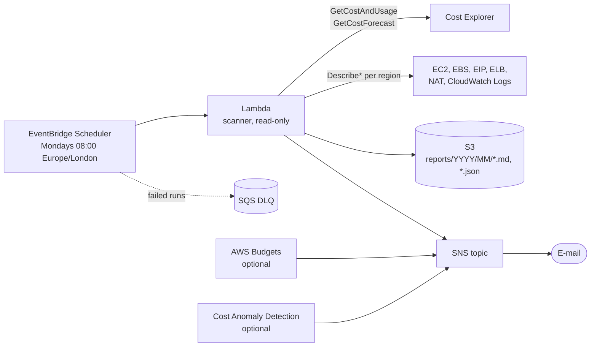

# AWS Cost and Unused Resource Scanner


A scheduled, read-only Lambda that answers two questions every week: "What are we spending?" and "What are we paying for but not using?". It reads Cost Explorer, scans each region for idle resources, writes a Markdown and JSON report to S3, and e-mails a short summary through SNS. Optional AWS Budgets and Cost Anomaly Detection alerts use the same topic.

Built with Terraform, Python 3.12, EventBridge Scheduler, Lambda, Cost Explorer, S3 and SNS.

## Architecture



<!-- Replace with an exported diagram after you deploy:
 -->

## Demo

> **Demo video:** _placeholder. Deploy, run `terraform output -raw run_now`, show the e-mail and the S3 report, and add the link here before you delete the AWS resources._

## What it finds

| Check | What it looks for | Cost estimate |
| --- | --- | --- |
| `EBS_UNATTACHED` | Volumes in the `available` state | size x price per GB-month for the volume type |
| `EIP_UNUSED` | Elastic IPs with no association | public IPv4 hourly price x 730 |
| `SNAPSHOT_OLD` | Your snapshots older than 90 days that no AMI uses | size x snapshot price (upper bound: snapshots are incremental) |
| `EC2_STOPPED` | Instances stopped for more than 14 days | price of the EBS volumes that are still attached |
| `LB_NO_TARGETS` | Load balancers with no registered targets | hourly price x 730 (LCU charges not included) |
| `NAT_IDLE` | NAT gateways with zero bytes out in 7 days | hourly price x 730 |
| `LOGS_NO_RETENTION` | Log groups set to never expire | stored GB x storage price |

Estimates use the us-east-1 on-demand list prices in `PRICES` (`src/scanner/unused.py`). Prices differ by region and change over time. Treat the numbers as a guide to sort the list, not as a bill.

The Lambda role has `Describe*`, `Get*` and Cost Explorer read permissions only, plus write access to its own bucket prefix and topic. It cannot delete anything.

### Example report

This output comes from the unit tests (fake data, not a real account):

```text
Subject: AWS cost report 111122223333: 2 unused resources, ~12 USD/month

Month to date: 120.50 USD
Change against the same days last month: +20.5%
Forecast for the month: 200.50 USD

Probably unused resources: 2 (about 11.65 USD per month)
      8.00  EBS_UNATTACHED     us-east-1    vol-1
      3.65  EIP_UNUSED         eu-west-2    eipalloc-1

Full report: s3://cost-scanner-reports-111122223333/reports/2026/11/2026-11-25T0800Z.md
```

## Design decisions

- **Read-only by design.** A cost tool that deletes resources by itself is a risk. The report names each resource and the suggested action. A person decides.
- **Fair comparison.** Month-to-date spend is compared with the same number of days last month, not with the full previous month.
- **Few Cost Explorer calls.** Cost Explorer charges per API request. Each run makes 4 calls in total, whatever the number of regions.
- **One failed region does not stop the report.** Errors are listed at the end of the report.
- **Native guardrails too.** `monthly_budget_usd` creates an AWS Budget (alert at 80% actual and 100% forecast). `anomaly_threshold_usd` creates a Cost Anomaly Detection monitor per service. Both publish to the same SNS topic.

## Deploy

Requirements: Terraform 1.6 or later and AWS credentials. Turn on Cost Explorer once in the Billing and Cost Management console (it can take up to 24 hours for data to appear).

```bash
cd terraform
cp terraform.tfvars.example terraform.tfvars
terraform init
terraform apply
```

Confirm the SNS subscription e-mail. Then run a scan now:

```bash
eval "$(terraform output -raw run_now)"
```

Set `scan_regions = ["all"]` to scan every enabled region. The scan takes longer, so the Lambda timeout is 10 minutes.

## Run the tests

```bash
python -m venv .venv && source .venv/bin/activate
pip install -r requirements-dev.txt
pytest --cov=scanner
```

EC2, ELB, CloudWatch, Logs, S3 and SNS are faked with moto. Cost Explorer is replaced by a small stub (`tests/conftest.py`). CI runs Ruff, pytest with a coverage gate, `terraform validate` and Checkov.

## Cost of the scanner itself

Lambda, Scheduler, S3 and SNS stay within the free tier at one run per week. Cost Explorer API requests are charged per request. The first two AWS Budgets are free. Check current prices on the AWS pricing pages.

## Clean up

```bash
terraform -chdir=terraform destroy
```

## Project layout

```text
src/scanner/unused.py   idle resource checks (read-only)
src/scanner/costs.py    Cost Explorer summary
src/scanner/report.py   Markdown report and e-mail text
src/scanner/handler.py  Lambda entry point
tests/                  moto-based tests and a Cost Explorer stub
terraform/              Scheduler, Lambda, S3, SNS, IAM, Budgets, Anomaly Detection
```

## Licence

MIT. See [LICENSE](LICENSE).
